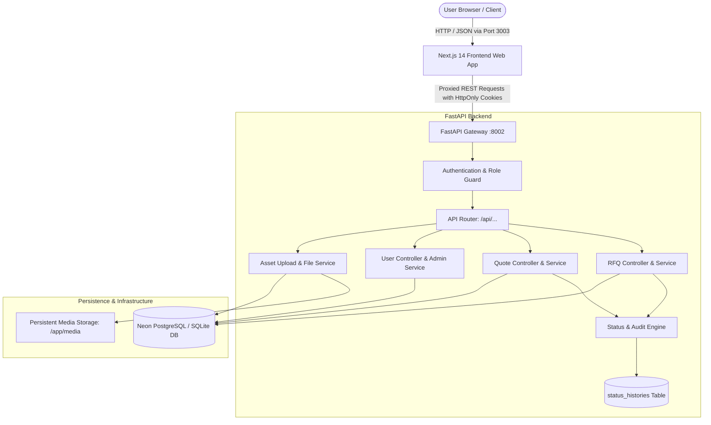
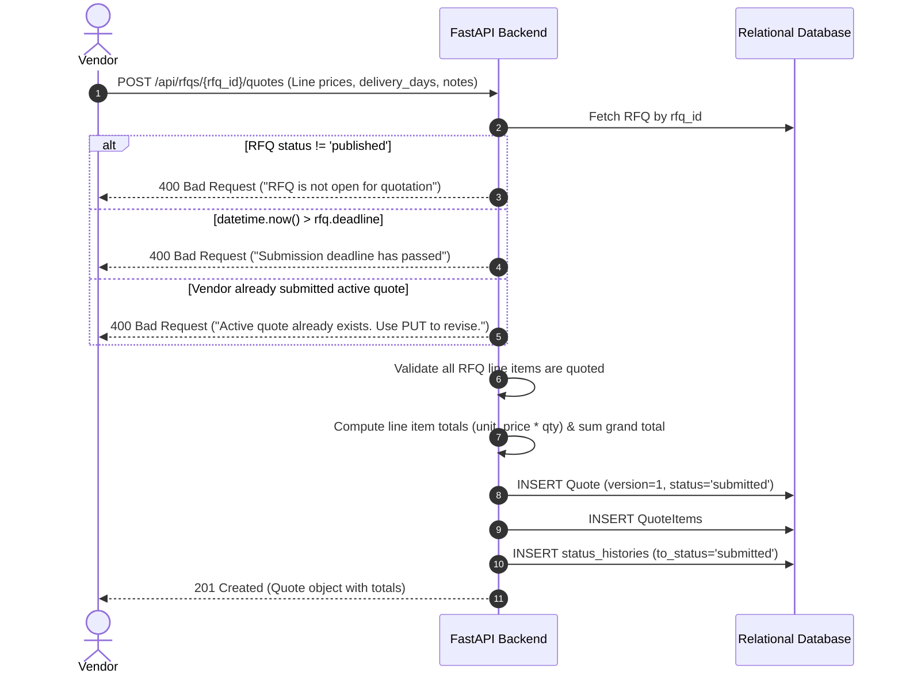
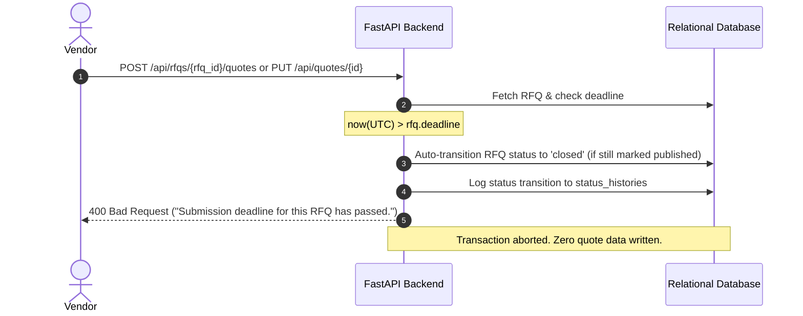
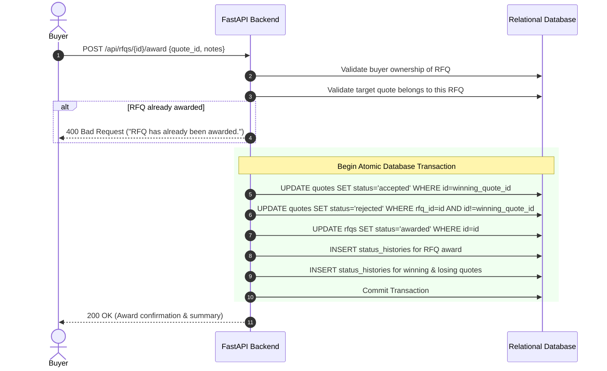

# Bidveda Mini RFQ Portal — System Design Document
*(Deliverable 1: Comprehensive Architectural Specification)*

**Author:** Lead Developer Candidate (Vivek Raiyani)  
**Date:** October 2026  
**Target:** Bidveda Engineering Team (`tech@bidveda.in`)  
**Project:** Mini Request for Quotation (RFQ) Portal  
**Repository:** [https://github.com/Vivek-Raiyani/bidveda](https://github.com/Vivek-Raiyani/bidveda)  

---

## 1. Requirement Understanding

### 1.1 The Problem in Our Own Words
In enterprise and B2B industrial procurement, the traditional Request for Quotation (RFQ) process is notoriously fragmented, reliant on manual email chains, unstandardized spreadsheets, and opaque offline negotiations. This introduces significant delays, calculation mistakes, and compliance vulnerabilities.

The **Bidveda Mini RFQ Portal** delivers a streamlined, transparent, and auditable procurement management system where:
1. **Buyer companies** publish structured RFQs specifying item descriptions, quantities, units of measure, target delivery locations, estimated budgets, and strict deadline cutoffs.
2. **Vendors** discover relevant open procurement requests, submit itemized per-unit pricing with delivery turnaround times and terms, and revise their proposals competitively prior to the deadline.
3. **Buyers** evaluate all competitive bids in an automated side-by-side comparison matrix (sortable by total financial outlay or turnaround speed) and award the purchase contract to the winning vendor through an atomic, transactional state update that automatically records status history and rejects competing bids.

### 1.2 Main User Flows by Role

#### 1. Buyer Flow
* **Create & Edit RFQ**: Draft an RFQ with title, category, delivery location, budget, submission deadline, and multiple line items (name, quantity, unit). Editable exclusively while in `draft` status.
* **Publish RFQ**: Promote an RFQ from `draft` to `published`. Once published, the core scope is locked to preserve fair bidding, and the request becomes visible to all vendors.
* **Granular Line Item Management**: Add, update, or remove line items while the RFQ is still in `draft`.
* **Evaluate Quotes**: Review incoming bids through an interactive comparison grid comparing line item unit rates, total expenditure, and delivery lead times.
* **Shortlist Promising Bids**: Optionally flag top contender bids as `shortlisted` during internal committee review.
* **Award Contract**: Select the winning bid. The system atomically transitions the RFQ to `awarded`, the winning quote to `accepted`, and all remaining competitor quotes to `rejected`, writing full audit entries into `status_histories`.

#### 2. Vendor Flow
* **Marketplace Discovery**: Search and filter published RFQs by keyword, category, delivery location, and upcoming deadline.
* **Quote Submission**: Submit an itemized quote providing unit rates for every requested line item, delivery turnaround in days, and commercial notes before the deadline passes.
* **Competitive Revision**: Update line pricing or delivery commitments as many times as necessary before the deadline. Each revision increments the quote `version` counter and updates the financial total.
* **Portfolio Tracking**: Monitor personal quotation history and live status (`submitted`, `shortlisted`, `accepted`, `rejected`) in an isolated vendor dashboard.

#### 3. Admin Flow
* **Platform Governance**: Full system-wide visibility across all user accounts, active RFQs, submitted quotes, and audit logs.
* **User Management**: Create, update, assign roles (`buyer`, `vendor`, `admin`), ban/unban, or deactivate user accounts with safeguards preventing self-demotion.

### 1.3 Scope Boundaries

* **In Scope**:
  * Role-based access control (`buyer`, `vendor`, `admin`) backed by secure HttpOnly JWT cookies.
  * Finite state machine for RFQ (`draft` → `published` → `closed` → `awarded`).
  * Finite state machine for Quotes (`submitted` → `shortlisted` → `accepted` / `rejected`).
  * Sealed-bid quotation model (vendors can never see competitors' pricing).
  * Per-line-item pricing with automated line totals and grand total calculation.
  * Unlimited pre-deadline quote revisions with automated version incrementing.
  * Real-time deadline enforcement and automatic background closing of expired RFQs.
  * Side-by-side comparative evaluation matrix sortable by total price and delivery days.
  * Atomic transactional award execution.
  * Status history and audit log tracking for all state transitions.
  * Safe file upload and download for RFQ specifications and vendor documentation (PDF, XLSX).
  * Automated test suite covering key flows, security isolation, and edge cases.
  * One-command Dockerized deployment.

* **Out of Scope (Deferred to Future Enterprise Iterations)**:
  * Multi-currency exchange engine and dynamic tax/GST calculation rules.
  * Partial split-line awards (e.g., awarding Item A to Vendor 1 and Item B to Vendor 2).
  * Real-time WebSocket bidirectional bidding rooms and countdown reverse auctions.

---

## 2. Assumptions and Open Questions

In accordance with the assignment guidelines, the following architectural and business assumptions were formalized:

| Area | Decision & Assumption | Rationale |
| :--- | :--- | :--- |
| **Quote Visibility** | **Strict Sealed Bidding**: Vendors cannot see any data regarding other vendors' quotes. Only the RFQ owner (Buyer) and Admin can view all bids. | In procurement, public bid visibility leads to bid shopping, price signaling, and cartel collusion. Sealed bidding guarantees fair market competition. |
| **Quote Revisions** | **Single Active Quote with In-Place Versioning**: A vendor can submit only one active quote per RFQ, but can revise it unlimited times before the deadline. | Revising updates the existing quote record in-place, increments the `version` counter, and updates line items, preventing clutter in the buyer's comparison view. |
| **Post-Deadline Policy** | **Strict Hard Cutoff with Auto-Close**: Once `now() > rfq.deadline`, no new quotes or revisions are accepted. Expired RFQs automatically transition from `published` to `closed`. | Fairness in commercial tenders requires strict enforcement of published deadlines. Real-time auto-close prevents race conditions. |
| **Storage of Money** | **SQL `NUMERIC(14, 2)` / Python `Decimal`**: Floating-point types (`float`, `double`) are strictly prohibited for monetary values. | IEEE 754 floating-point numbers introduce binary rounding artifacts (e.g. `0.1 + 0.2 = 0.30000000000000004`). Procurement ledgers require exact decimal math. |
| **Buyer / Vendor Duality** | **Single Role Identity per Account**: A user has a distinct primary role (`buyer` or `vendor`). An individual requiring both functions operates two separate accounts. | Prevents identity confusion and privilege escalation where a buyer might accidentally submit quotes against their own tenders. |
| **RFQ Line Item Editing** | **Editable in Draft Only**: Once an RFQ is `published`, line items are permanently locked. | Modifying quantities or specifications while vendors are actively preparing or submitting bids would invalidate existing quotes and violate fairness. |
| **File Storage & Safety** | **UUID Key Renaming & MIME Whitelist**: Files are renamed with random UUIDs and checked against a whitelist (`.pdf`, `.xlsx`, `.xls`, `.png`, `.jpg`). | Prevents directory traversal attacks (`../../`), malicious script execution (`.php`, `.sh`), and accidental file collisions. |
| **Status History Tracking** | **Dedicated Audit Ledger (`status_histories`)**: All state transitions record `entity_type`, `entity_id`, `from_status`, `to_status`, `changed_by_id`, and timestamp. | Enterprise procurement mandates complete traceability for compliance and dispute resolution. |

---

## 3. Tech Stack and Reasoning

```
┌────────────────────────────────────────────────────────┐
│                        Frontend                        │
│         Next.js 14 · React 18 · TypeScript · Bun       │
│           TailwindCSS · Lucide Icons · Axios           │
└───────────────────────────┬────────────────────────────┘
                            │ REST / JSON (Secure HttpOnly JWT Cookies)
┌───────────────────────────▼────────────────────────────┐
│                    FastAPI Backend                     │
│    Python 3.12 / 3.14 · Pydantic v2 · SQLAlchemy 2.0   │
│         Asyncpg Pool · Uvicorn ASGI Server             │
└───────────────────────────┬────────────────────────────┘
                            │ Async SQL Driver (Asyncpg)
┌───────────────────────────▼────────────────────────────┐
│                    Relational Database                 │
│         Neon Serverless PostgreSQL (Production)         │
│               SQLite (Development & Tests)             │
│                Alembic Schema Migrations               │
└────────────────────────────────────────────────────────┘
```

### Stack Component Selection & Alternatives Evaluated

#### 1. Backend: FastAPI (Python)
* **Why Chosen**: Asynchronous execution model, native Pydantic v2 data validation, type annotations, and automated OpenAPI (Swagger) documentation generation.
* **Alternatives Considered**:
  * *Node.js / Express*: Lacks built-in declarative schema validation and requires additional libraries for type safety and OpenAPI sync.
  * *Django / DRF*: Heavier overhead, synchronous ORM default, and less lightweight for clean microservice and API-first designs.

#### 2. Frontend: Next.js 14 (React, TypeScript, TailwindCSS)
* **Why Chosen**: Modern React component architecture, server and client component separation, built-in routing, and TailwindCSS for responsive enterprise layouts.
* **Alternatives Considered**:
  * *Vite Single Page App (SPA)*: Faster build, but requires extra routing libraries and client-side auth state handling without SSR benefits.
  * *Remix*: Excellent framework, but Next.js has broader ecosystem adoption and faster Docker standalone packaging.

#### 3. Database: PostgreSQL (Neon) & SQLite (Local/Test)
* **Why Chosen**: ACID compliance, native UUID support, robust relational integrity with foreign keys, and enterprise locking primitives. Hosted on Neon serverless PostgreSQL with connection pooling (PgBouncer compatibility with `statement_cache_size=0`).
* **Alternatives Considered**:
  * *MySQL*: Less flexible UUID handling and fewer JSON/analytical features.
  * *MongoDB / NoSQL*: Non-relational structure is fundamentally unsuitable for transactional procurement contracts requiring strict foreign key cascades and relational comparisons.

#### 4. File Storage: Local Persistent Volume / S3 Architecture
* **Why Chosen**: Uploaded files stored in persistent volumes (`media/`) with database metadata tracking (`assets` table). Designed with an extensible interface allowing seamless redirection to AWS S3 or Cloudflare R2 without changing API contracts.
* **Alternatives Considered**:
  * *Database BLOBs*: Storing files inside database tables causes massive database bloat and severe memory penalties during query execution.

#### 5. Deployment: Docker & Docker Compose
* **Why Chosen**: Containerized multi-stage builds (Bun for Next.js, Python slim for FastAPI) providing deterministic, reproducible environments with a single command (`docker compose up --build`).

---

## 4. Architecture and Services



### Component Responsibilities:
1. **Frontend App (`frontend/`)**: Renders reactive procurement views including RFQ creator, vendor bid submission form, side-by-side comparison matrix, and admin user portal.
2. **API Layer (`backend/app/api/`)**: Dispatches incoming requests to dedicated route controllers (`auth`, `request_quote`, `quote`, `users`, `assets`).
3. **Dependency Injection & Guards (`backend/app/api/deps.py`)**: Validates JWT signatures, resolves database sessions, and enforces role policies (`require_roles`).
4. **Service & Domain Layer (`backend/app/models/` & `services`)**: Implements pricing arithmetic, version incrementing, deadline validations, and atomic transaction execution.
5. **Database & Migrations (`backend/alembic/`)**: Version-controlled DDL migrations guaranteeing schema synchronization across local, Docker, and cloud environments.

---

## 5. Database Model

The database schema is fully normalized, enforcing strict foreign key constraints, cascading deletes, and strategic B-Tree indexing on filtering columns (`status`, `deadline`, `buyer_id`, `vendor_id`).

```
                    ┌───────────────────────────────────┐
                    │               users               │
                    ├───────────────────────────────────┤
                    │ id: UUID (PK)                     │
                    │ email: VARCHAR(255) (UNIQUE, IDX) │
                    │ hashed_password: VARCHAR(255)     │
                    │ first_name: VARCHAR(100)          │
                    │ last_name: VARCHAR(100)           │
                    │ role: VARCHAR(50) (IDX)           │
                    │ is_deleted: BOOLEAN (DEFAULT 0)   │
                    │ created_at, updated_at: TIMESTAMP │
                    └─────────────────┬─────────────────┘
                                      │ 1
                 ┌────────────────────┴────────────────────┐
                 │ 1                                       │ 1
                 ▼ *                                       ▼ *
    ┌─────────────────────────┐               ┌─────────────────────────┐
    │          rfqs           │ 1           * │         quotes          │
    ├─────────────────────────┤───────────────├─────────────────────────┤
    │ id: UUID (PK)           │               │ id: UUID (PK)           │
    │ buyer_id: UUID (FK, IDX)│               │ rfq_id: UUID (FK, IDX)  │
    │ title: VARCHAR(255)(IDX)│               │ vendor_id: UUID(FK, IDX)│
    │ description: TEXT       │               │ version: INT (DEFAULT 1)│
    │ category: VARCHAR (IDX) │               │ delivery_days: INT (IDX)│
    │ delivery_location: STR  │               │ notes: TEXT             │
    │ budget: NUMERIC(14,2)   │               │ total_amount: NUMERIC   │
    │ deadline: TIMESTAMPTZ   │               │ status: VARCHAR(50)(IDX)│
    │ status: VARCHAR(50)(IDX)│               │ created_at, updated_at  │
    └────────────┬────────────┘               └────────────┬────────────┘
                 │ 1                                       │ 1
                 │                                         │
                 ▼ *                                       ▼ *
    ┌─────────────────────────┐ 1               * ┌───────────────────────┐
    │     rfq_line_items      │──────────────────>│      quote_items      │
    ├─────────────────────────┤                   ├───────────────────────┤
    │ id: UUID (PK)           │                   │ id: UUID (PK)         │
    │ rfq_id: UUID (FK, IDX)  │                   │ quote_id: UUID(FK,IDX)│
    │ name: VARCHAR(255)      │                   │ line_item_id:UUID(FK) │
    │ quantity: NUMERIC(12,2) │                   │ unit_price: NUMERIC   │
    │ unit: VARCHAR(50)       │                   │ total_price: NUMERIC  │
    └─────────────────────────┘                   └───────────────────────┘

                 ┌─────────────────────────────────────────┐
                 │            status_histories             │
                 ├─────────────────────────────────────────┤
                 │ id: UUID (PK)                           │
                 │ entity_type: VARCHAR(50) ("rfq"|"quote")│
                 │ entity_id: UUID (IDX)                   │
                 │ from_status: VARCHAR(50)                │
                 │ to_status: VARCHAR(50)                  │
                 │ changed_by_id: UUID (FK, NULLABLE)      │
                 │ notes: TEXT                             │
                 │ created_at: TIMESTAMP                   │
                 └─────────────────────────────────────────┘

                 ┌─────────────────────────────────────────┐
                 │                 assets                  │
                 ├─────────────────────────────────────────┤
                 │ id: UUID (PK)                           │
                 │ uploaded_by: UUID (FK, IDX)             │
                 │ folder: VARCHAR                         │
                 │ filename: VARCHAR                       │
                 │ storage_key: VARCHAR (UNIQUE)           │
                 │ file_url: VARCHAR                       │
                 │ content_type: VARCHAR                   │
                 │ file_size: INT                          │
                 │ status: VARCHAR                         │
                 │ created_at: TIMESTAMP                   │
                 └─────────────────────────────────────────┘
```

### Explanations of Core Storage Decisions:
1. **Money**: Stored strictly as `NUMERIC(14, 2)` (mapped to Python `Decimal`), eliminating floating-point rounding errors across line calculations and grand totals.
2. **Line Items**: Stored in `rfq_line_items` with a foreign key referencing `rfqs.id` (`ON DELETE CASCADE`). Quantities use `NUMERIC(12, 2)` to permit fractional units (e.g., kilograms, hours).
3. **Quote Items**: `quote_items` links `quotes.id` and `rfq_line_items.id`. The backend calculates `total_price = unit_price * line_item.quantity` server-side to prevent client tampering.
4. **Quote Revisions**: Tracked through the `version` integer column on `quotes`. When a vendor revises a quote before the deadline:
   - The quote `version` is incremented (`version = version + 1`).
   - Prior `quote_items` are replaced in the transaction with the new unit prices.
   - The grand total is recalculated.
   - A revision entry is appended to `status_histories`.
5. **Status History & Audit Trail**: The `status_histories` table maintains an immutable log of every lifecycle transition for both RFQs and Quotes, storing prior status, target status, actor ID, and optional reasoning.

---

## 6. API Design

### Complete API Endpoints Catalog

| Method | Endpoint | Allowed Roles | Description |
| :--- | :--- | :--- | :--- |
| `POST` | `/api/auth/register` | Public | Register new Buyer or Vendor account |
| `POST` | `/api/auth/login` | Public | Authenticate user & issue HttpOnly JWT cookies |
| `POST` | `/api/auth/logout` | Authenticated | Invalidate session & clear auth cookies |
| `GET` | `/api/auth/me` | Authenticated | Retrieve current user profile & permissions |
| `GET` | `/api/rfqs` | Authenticated | Browse published RFQs (with search, category, location, pagination) |
| `GET` | `/api/rfqs/my` | `Buyer`, `Admin` | List buyer's own RFQs with received bid counts |
| `POST` | `/api/rfqs` | `Buyer`, `Admin` | Create RFQ with line items in `draft` status |
| `GET` | `/api/rfqs/{id}` | Authenticated | RFQ details (includes real-time auto-close check) |
| `PUT` | `/api/rfqs/{id}` | `Buyer` (Owner), `Admin` | Update draft RFQ specifications and line items |
| `DELETE`| `/api/rfqs/{id}` | `Buyer` (Owner), `Admin` | Soft delete RFQ (drafts only) |
| `POST` | `/api/rfqs/{id}/publish` | `Buyer` (Owner), `Admin` | Transition RFQ status to `published` |
| `POST` | `/api/rfqs/{id}/line-items` | `Buyer` (Owner), `Admin` | Add individual line item to draft RFQ |
| `PUT` | `/api/rfqs/{id}/line-items/{item_id}` | `Buyer` (Owner), `Admin` | Update line item quantity or unit |
| `DELETE`| `/api/rfqs/{id}/line-items/{item_id}` | `Buyer` (Owner), `Admin` | Delete individual line item from draft RFQ |
| `GET` | `/api/rfqs/{id}/compare` | `Buyer` (Owner), `Admin` | Side-by-side comparison matrix sortable by price/delivery |
| `POST` | `/api/rfqs/{id}/award` | `Buyer` (Owner), `Admin` | Atomically award RFQ to winning quote |
| `GET` | `/api/rfqs/{id}/status-history`| `Buyer`, `Admin` | View status transition audit trail for RFQ |
| `POST` | `/api/rfqs/{rfq_id}/quotes` | `Vendor`, `Admin` | Submit initial quote with per-line pricing |
| `PUT` | `/api/quotes/{id}` | `Vendor` (Owner), `Admin` | Revise quote pricing before deadline |
| `GET` | `/api/quotes/my` | `Vendor`, `Admin` | List vendor's personal submitted quotes |
| `GET` | `/api/quotes/{id}` | Authenticated | View quote details (enforces vendor isolation) |
| `POST` | `/api/quotes/{id}/shortlist`| `Buyer` (Owner), `Admin` | Shortlist promising quote during evaluation |
| `GET` | `/api/quotes/{id}/status-history`| Authenticated | View status history for quote |
| `POST` | `/api/assets/upload` | Authenticated | Upload PDF/XLSX attachments with UUID storage key |
| `GET` | `/api/assets/{id}` | Authenticated | Retrieve asset metadata and download URL |
| `GET` | `/api/users` | `Admin` | List and search all platform users |
| `POST` | `/api/users` | `Admin` | Manually provision new platform user |
| `PATCH` | `/api/users/{id}` | `Admin` | Modify user role, details, or active status |

---

### Request and Response Examples for 3 Core Endpoints

#### 1. Submit Quote (`POST /api/rfqs/{rfq_id}/quotes`)
* **Request**:
```json
{
  "delivery_days": 10,
  "notes": "Standard commercial proposal with 12-month manufacturer warranty.",
  "items": [
    {
      "line_item_id": "8488e025-a134-4b53-b184-fb727ca1bc87",
      "unit_price": 1900.00
    },
    {
      "line_item_id": "31b6727d-992a-4340-8b17-e818fffae951",
      "unit_price": 8000.00
    }
  ]
}
```
* **Response (`HTTP 201 Created`)**:
```json
{
  "code": 201,
  "data": {
    "id": "5c711b89-a147-439f-ba4c-fbc8bb864845",
    "rfq_id": "60597557-9066-4568-b8b7-e881bd8b67c9",
    "vendor_id": "535bfbaa-950a-4186-aa38-c0df5e30bb2a",
    "vendor_name": "Vendor Alpha",
    "version": 1,
    "delivery_days": 10,
    "notes": "Standard commercial proposal with 12-month manufacturer warranty.",
    "total_amount": "350000.00",
    "status": "submitted",
    "items": [
      {
        "id": "e4444585-6484-4fe1-ba09-5a1bfceca245",
        "line_item_id": "8488e025-a134-4b53-b184-fb727ca1bc87",
        "line_item_name": "Chairs",
        "quantity": "100.00",
        "unit": "chairs",
        "unit_price": "1900.00",
        "total_price": "190000.00"
      },
      {
        "id": "fa2136e0-2544-42ea-9c3f-d31e9f02fe18",
        "line_item_id": "31b6727d-992a-4340-8b17-e818fffae951",
        "line_item_name": "Desks",
        "quantity": "20.00",
        "unit": "desks",
        "unit_price": "8000.00",
        "total_price": "160000.00"
      }
    ],
    "created_at": "2026-10-16T12:00:00Z"
  }
}
```

#### 2. Side-by-Side Comparison Matrix (`GET /api/rfqs/{id}/compare?sort_by=delivery_days&sort_order=asc`)
* **Response (`HTTP 200 OK`)**:
```json
{
  "code": 200,
  "data": {
    "rfq_id": "60597557-9066-4568-b8b7-e881bd8b67c9",
    "rfq_title": "Office supplies for Hyderabad site",
    "rfq_status": "published",
    "deadline": "2026-11-20T17:00:00Z",
    "line_items": [
      {
        "id": "8488e025-a134-4b53-b184-fb727ca1bc87",
        "name": "Chairs",
        "quantity": "100.00",
        "unit": "chairs"
      },
      {
        "id": "31b6727d-992a-4340-8b17-e818fffae951",
        "name": "Desks",
        "quantity": "20.00",
        "unit": "desks"
      }
    ],
    "quotes": [
      {
        "quote_id": "71b77bac-3d27-41db-9498-9ad3680de88b",
        "vendor_id": "c1f1fe68-3e9a-4e20-8041-38290bc5774a",
        "vendor_name": "Vendor Beta",
        "version": 1,
        "delivery_days": 7,
        "total_amount": "360000.00",
        "status": "submitted",
        "item_prices": [
          {"line_item_id": "8488e025-a134-4b53-b184-fb727ca1bc87", "unit_price": "2200.00", "total_price": "220000.00"},
          {"line_item_id": "31b6727d-992a-4340-8b17-e818fffae951", "unit_price": "7000.00", "total_price": "140000.00"}
        ]
      },
      {
        "quote_id": "5c711b89-a147-439f-ba4c-fbc8bb864845",
        "vendor_id": "535bfbaa-950a-4186-aa38-c0df5e30bb2a",
        "vendor_name": "Vendor Alpha",
        "version": 2,
        "delivery_days": 10,
        "total_amount": "350000.00",
        "status": "submitted",
        "item_prices": [
          {"line_item_id": "8488e025-a134-4b53-b184-fb727ca1bc87", "unit_price": "1900.00", "total_price": "190000.00"},
          {"line_item_id": "31b6727d-992a-4340-8b17-e818fffae951", "unit_price": "8000.00", "total_price": "160000.00"}
        ]
      }
    ]
  }
}
```

#### 3. Award RFQ Contract (`POST /api/rfqs/{id}/award`)
* **Request**:
```json
{
  "quote_id": "71b77bac-3d27-41db-9498-9ad3680de88b",
  "notes": "Selected Vendor Beta due to urgent 7-day delivery requirement."
}
```
* **Response (`HTTP 200 OK`)**:
```json
{
  "code": 200,
  "data": {
    "rfq_id": "60597557-9066-4568-b8b7-e881bd8b67c9",
    "awarded_quote_id": "71b77bac-3d27-41db-9498-9ad3680de88b",
    "awarded_vendor_id": "c1f1fe68-3e9a-4e20-8041-38290bc5774a",
    "awarded_vendor_name": "Vendor Beta",
    "total_amount": "360000.00",
    "delivery_days": 7,
    "status": "awarded",
    "message": "RFQ successfully awarded to Vendor Beta."
  }
}
```

---

## 7. Key Flows

### Flow 1: Submitting a Quote Before the Deadline


### Flow 2: Rejecting a Late Quote


### Flow 3: Awarding an RFQ Contract


---

## 8. Security and Access Control

### 8.1 Role-Based Access Control (RBAC)
* **JWT Inside HttpOnly Cookies**: Tokens are never stored in browser `localStorage` or `sessionStorage`, making them immune to token theft via Cross-Site Scripting (XSS).
* **SameSite & Secure Flags**: Cookies are marked `SameSite=Lax` (preventing CSRF during cross-origin requests) and dynamically set `Secure=True` in production HTTPS environments.
* **Declarative Role Injection**: Endpoints declare explicit authorization requirements via `deps.require_roles(UserRoleEnum.BUYER, UserRoleEnum.ADMIN)`.

### 8.2 Sealed-Bid Isolation and Data Protection
* **Direct Object Reference (IDOR) Protection**: In `GET /api/quotes/{id}` and `PUT /api/quotes/{id}`, if the requesting user is a vendor, the system enforces `quote.vendor_id == current_user.id`. Any unauthorized vendor querying another vendor's bid receives `403 Forbidden`.
* **Sealed Marketplace**: The public RFQ query endpoint (`GET /api/rfqs/{id}`) strictly excludes quote objects from the payload response.
* **Buyer Isolation**: A buyer cannot edit, publish, or award an RFQ owned by another buyer.

### 8.3 Safe File Handling
* **Strict Whitelist Validation**: Only approved document and image MIME types (`.pdf`, `.xlsx`, `.xls`, `.csv`, `.png`, `.jpg`) are permitted. Executable extensions (`.exe`, `.sh`, `.py`, `.php`, `.js`) are immediately rejected.
* **Path Traversal Prevention**: Original filenames provided by clients are sanitized. Files are saved under unique cryptographic UUID storage keys (`uuid4()`), making directory traversal attacks (`../../`) impossible.
* **File Size Caps**: Uploads are capped at 25MB to prevent storage denial-of-service.

---

## 9. Test Cases and Coverage

### 9.1 Test Cases Matrix

| Category | Test Case Name | Description & Expected Outcome | Status |
| :--- | :--- | :--- | :--- |
| **Core Flow** | `test_submit_quote_before_deadline_success` | Vendor submits valid quote before deadline; verifies calculation of item totals, `version=1`, and status `submitted`. | **Implemented** (Automated) |
| **Edge Case** | `test_reject_quote_submission_after_deadline` | Submission attempted after deadline cutoff; asserts immediate rejection with `400 Bad Request`. | **Implemented** (Automated) |
| **Core Flow** | `test_vendor_revising_quote` | Vendor updates unit pricing prior to deadline; verifies `version` increments to 2 and grand total recalculates. | **Implemented** (Automated) |
| **Edge Case** | `test_reject_quote_revision_after_deadline` | Vendor attempts to revise quote after deadline elapses; asserts rejection with `400 Bad Request`. | **Implemented** (Automated) |
| **Core Flow** | `test_award_flow_status_transitions` | Buyer awards winning quote; verifies atomic transaction updating RFQ to `awarded`, winner to `accepted`, and competitor to `rejected`. | **Implemented** (Automated) |
| **Security** | `test_vendor_isolation_security` | Vendor A attempts to read Vendor B's quote -> returns `403 Forbidden`. Buyer can read all bids -> returns `200 OK`. | **Implemented** (Automated) |
| **Security** | `test_buyer_isolation_security` | Buyer A attempts to edit or award Buyer B's RFQ -> returns `403 Forbidden`. | **Implemented** (Automated) |
| **Lifecycle** | `test_auto_close_expired_rfq_realtime` | Queries RFQ whose deadline elapsed; asserts real-time status update to `closed` and removal from open marketplace. | **Implemented** (Automated) |
| **Feature** | `test_rfq_line_item_crud_endpoints` | Adds, modifies, and deletes individual line items on a draft RFQ. | **Implemented** (Automated) |
| **Feature** | `test_quote_shortlisting` | Buyer transitions quote from `submitted` to `shortlisted`. | **Implemented** (Automated) |
| **Audit** | `test_status_history_tracking` | Asserts every state change writes corresponding records to `status_histories`. | **Implemented** (Automated) |
| **RBAC** | `test_admin_user_management_suite` | Admin lists, creates, modifies, and bans accounts while enforcing self-demotion safeguards. | **Implemented** (Automated) |
| **Scale / Load** | *High concurrency race at deadline* | 50 concurrent revisions during the final 100 milliseconds before deadline cutoff. | *Deferred for Future* |
| **Security** | *Antivirus file content scanning* | Deep payload inspection for embedded macro viruses inside uploaded `.xlsx` files. | *Deferred for Future* |
| **Feature** | *Multi-page pagination stress* | Loading 10,000+ line items with database chunk streaming. | *Deferred for Future* |

---

## 10. Scalability and Next Steps

### 10.1 What Breaks First at 100x Load
1. **Database Connection Pool Exhaustion**: In procurement portals, up to 70% of quote activity concentrates in the final 15 minutes before tender deadlines. Hundreds of vendors concurrently opening transactions will exhaust the PostgreSQL connection limit.
2. **Comparison Matrix Computation**: Assembling side-by-side matrices for RFQs containing hundreds of items across dozens of vendors involves heavy nested joins and in-memory aggregation.

### 10.2 Architectural Evolution for 100x Scale
1. **Connection Pooling via PgBouncer**:
   - Route all asyncpg database connections through PgBouncer in transaction pooling mode (already pre-configured in our database setup using `statement_cache_size=0`).
2. **Distributed Redis Caching**:
   - Cache published RFQ details and static specification files in Redis with time-to-live (TTL). Invalidate only when an RFQ is modified or awarded.
3. **Background Asynchronous Workers**:
   - Offload heavy tasks (generating PDF comparison exports, sending email notifications upon RFQ publication or award) to Celery / ARQ workers backed by Redis.
4. **Optimistic Concurrency Control**:
   - Utilize the `version` column on quotes with database row version checks (`WHERE id = :id AND version = :expected_version`) to handle high-frequency vendor revisions without table locks.

### 10.3 What Was Skipped on Purpose
- **Split-Line Multi-Vendor Awards**: Skipped to keep the contract award state machine deterministic and focused on the core must-have workflow.
- **Complex Reverse Auctions**: Real-time reverse auctioning creates significant WebSocket connection management overhead that was non-essential for the core RFQ specification.
